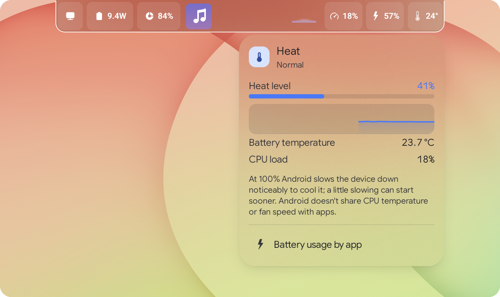
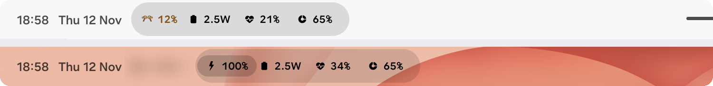
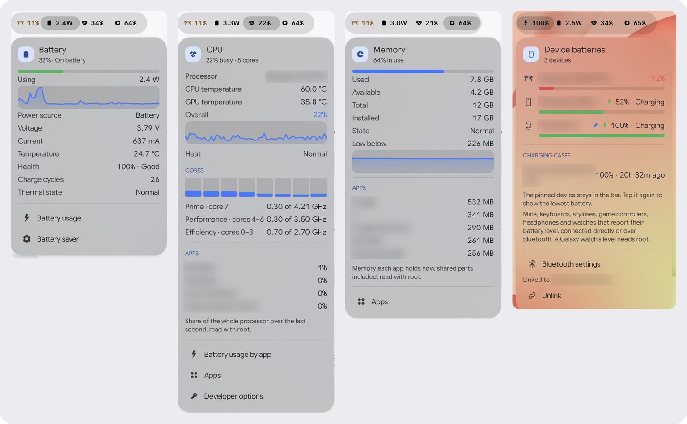
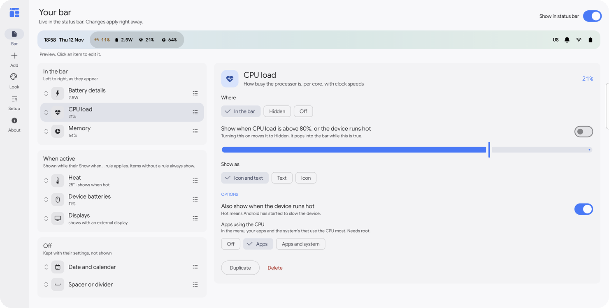
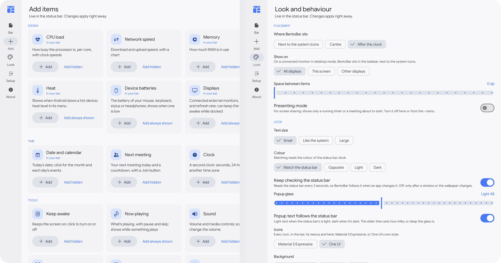

  

<h1 align="center">BentoBar</h1>

  <b>Add, hide and organise items in your status bar: on a Googlebook, and on Samsung tablets and phones with One UI.</b> 
  Your own items next to the system's icons, as an ordinary Android app: no root, no adb. With root, it reads more.

  <a href="../../releases/latest/download/BentoBar.apk"><b>⬇ Download BentoBar.apk</b></a>
  &nbsp;·&nbsp; <a href="#install">Install</a>
  &nbsp;·&nbsp; <a href="#privacy">Privacy</a>
  &nbsp;·&nbsp; <a href="../../releases">What's new</a>

  
  
  
  
  
  

> **This is a fork** of [Meridian11Labs/bentobar](https://github.com/Meridian11Labs/bentobar), on the `notch-items`
> branch, made for Samsung tablets and phones with One UI. Everything it adds is in
> [What this fork adds](#what-this-fork-adds), with the details in [How it works](HOW-IT-WORKS.md). Its releases are
> signed with a different key than the official app's: uninstall the official BentoBar before installing one.

## What this fork adds

- **BentoBar in a Dynamic Island:** your items as wings of [Fonta's Dynamic Notch for Android](https://github.com/Nessuno6/FontaDynamicNotch/tree/android),
  their menus a tap (or a mouse hover) away, and BentoBar's own bar out of the way while the notch shows them.
  [How it works](HOW-IT-WORKS.md#bentobar-in-a-dynamic-island)
- **On a second display:** a bar of its own in a monitor's taskbar (DeX or desktop mode), which the notch never takes.
  [How it works](HOW-IT-WORKS.md#on-a-second-display)
- **One UI's look:** every icon in One UI's style, or Material 3 Expressive (**Look › Icons**), and One UI's own dialogs.
  [How it works](HOW-IT-WORKS.md#one-uis-look)
- **Widgets:** Device batteries on the home screen and on **One UI's lock screen**. [How it works](HOW-IT-WORKS.md#widgets)
- **Another device's batteries:** link your phone and tablet over Google's Cross device SDK, and each shows the other's
  battery and devices. [How it works](HOW-IT-WORKS.md#another-devices-batteries-cross-device-sdk)
- **Charging cases and charge speed:** the earbuds' case as last seen, and Samsung's charging steps up to Super fast
  2.0. [How it works](HOW-IT-WORKS.md#device-batteries-further)
- **Updates from inside the app:** checks six times a day, and installs with your OK. [How it works](HOW-IT-WORKS.md#updates-from-inside-the-app)
- **Root (optional):** temperatures, the apps using the CPU and memory, the battery's real cycles and health, a Galaxy
  watch's and earbuds' levels. [What root adds, and why](HOW-IT-WORKS.md#root)

BentoBar is made by Meridian11 LLC, developed on a Googlebook. This fork adds to it, and is tested on a
Samsung Galaxy tablet with One UI 9; Meridian11 doesn't make or support it (<a href="#about-this-project">more</a>).

  

## What it does

BentoBar puts **your own items** into the empty part of the status bar, right next to the
system's icons, in the same font and colour. Items you don't need all the time can show only while
they have something to say, or wait **behind the ‹ button**: one click reveals them, another folds
them away. Like a bento box: everything in its compartment, and the whole thing neat.

  
   BentoBar after the clock on a One UI tablet: over an app (top), and over the wallpaper with Device batteries' menu open (bottom).

- **Show when active:** a hidden item can pop out on its own while it has something to say, such
  as a running timer, a meeting about to start or a busy CPU, and disappear again after. Its
  settings say the rule in words ("Show when CPU load is above 80%") and let you set the number.
- **Drag to reorder** in settings, within a section or into another one.
- **Click any item** for its menu: charts, details and actions.
- **Right-click an item** to hide it, move it or change how it looks.
- **Scroll** over the sound item to change the volume, or over the timer to add minutes. The sound
  item can also draw a **volume slider** right in the bar.
- **Quick Settings tiles** switch BentoBar off (for presenting), keep the screen awake, or start a
  25-minute timer.
- **Live Update chip:** when BentoBar is off, a running timer still shows as Android's own status
  bar chip.

BentoBar stays out of the way. It moves aside when the system's own icons or chips change, and
hides when an app goes full screen or the screen locks.

## Items

| Item | In the bar | In its menu |
|---|---|---|
| **CPU load** | busy %; can also pop out when the device runs hot | chart, per-core load, clock speeds, GPU load; with [root](HOW-IT-WORKS.md#root), CPU and GPU temperatures and the apps using the CPU |
| **Network speed** | ↓ download ↑ upload | chart, totals since start-up, connection |
| **Memory** | RAM in use | used, available, chart; with [root](HOW-IT-WORKS.md#root), the apps holding the most memory |
| **Battery details** | watts, %, temperature or time to full; while charging, its icon shows the charge speed (a double bolt for Super fast 2.0) | power in or out, charge speed, voltage, current, health, cycles (the real ones and health in percent with [root](HOW-IT-WORKS.md#root)), thermal state |
| **Storage** | free space | used and free, shortcuts to clean up |
| **Date and calendar** | the date, in your format | a month view, and the day's events (all-day ones too) with **Join** and **Directions**; tasks that apps like Todoist sync to your calendar are left out, here and in Next meeting |
| **Next meeting** | title and countdown, until 3 a.m. tomorrow; just the icon when there are no more meetings | today's meetings with **Join** and **Directions** |
| **Clock** | a second clock: seconds, 24-hour or another city | world clocks: add cities in the menu, and **Plan a time**, a slider that shows any time of day in every city (copy the line, or start a calendar event there) |
| **Timer** | countdown, stopwatch or Pomodoro | start, pause, +1 min, stop |
| **Countdown** | days and hours to a date | exact time left |
| **Keep awake** | coffee cup: click to switch | 15 min to "until I turn it off" |
| **Sound** | volume, as a number or as a slider you click or drag | volume slider, play/pause/next |
| **Now playing** | the title while something plays | artwork, position, previous, play and next, other players. The title needs notification access (optional); without it the item still shows that something plays and controls it |
| **Device batteries** | the lowest of your mouse, keyboard, stylus, controller, earbuds or watch, when it's low | every device that reports a battery, the earbuds' cases as last seen, and a linked phone or tablet running BentoBar; a Galaxy watch, ring or earbuds through Samsung's own list with [root](HOW-IT-WORKS.md#root) |
| **External displays** | connected monitor resolution & refresh rate (`4K 60Hz`), when plugged in | every display's resolution, refresh rate and HDR status, plus **Keep awake while connected** |
| **Heat** | a word when Android slows a hot device | heat level, battery temperature |
| **Clipboard & scratchpad** | latest snippet preview or count | pinned snippets and session clipboard history; click any row to copy and optionally paste into the active field |
| **Weather** *(online)* | conditions and temperature of a city you pick or of where you are; rain or snow that is coming; optionally a word for the sky ("Partly cloudy", "Windy") | the next hours and days, sunrise and sunset. From [Open-Meteo](https://open-meteo.com) |
| **Air quality & UV** *(online)* | US or European AQI and/or UV index for your city or location; pops out when AQI or UV is high | AQI band, PM2.5, PM10, Ozone ($\text{O}_3$), current and max daily UV. From [Open-Meteo](https://open-meteo.com) |
| **Flight** *(online)* | a line with the plane where the flight is, a countdown to departure with the gate, then to landing, and delays | times at both airports, terminal, gate, baggage belt; a choice where a number flies more than once a day. From AirLabs, with a free key of your own |
| **US stocks** *(online)* | US stocks you pick, one at a time (`AAPL 227.52 ▲1.2%`) for 3 seconds to a minute each, as you choose; can pop out on a big move | each stock's price, day change and range, and the market's hours. From [Finnhub](https://finnhub.io), with a free key of your own |
| **Exchange rates** *(online)* | currency pairs you follow (`EUR/USD 1.0942`), rotating in the bar; can pop out on a big daily move | rate and daily % change for up to 6 pairs, plus an inline currency converter. From the European Central Bank via [Frankfurter](https://frankfurter.dev) (no key needed) |
| **Tools** | toolbox | screenshot, lock, overview, all apps, power, settings shortcuts |
| **Shortcut** | one action, as its icon, its name or both (📷 Screenshot) | none: a click does it. Screenshot, Report a bug (on a Googlebook, its Feedback app), lock, overview, all apps, notifications, Quick settings |
| **App folder** / **App shortcut** | your apps | a grid of apps / one click to open |
| **Text or emoji**, **Spacer** | anything you like | optional link |

  
   Battery, CPU, Memory and Device batteries, each under its item. With root, the CPU menu adds temperatures and the apps using it, and Memory the apps holding it. Names and apps are blurred.

## Settings

A live preview of your bar at the top; below it, your items in three groups (**in the bar**,
**hidden** and **off**; drag a row to move it) with each item's options on the right. Changes apply to the
status bar right away.

  

  
   Adding items, and choosing where BentoBar sits and how it looks, with Icons: Material 3 Expressive or One UI.

## Install

BentoBar was made for Googlebooks (Googlebook OS, Android 17); this fork is made and tested on a Samsung Galaxy tablet
with One UI 9 (Android 17), and runs on Android 14 or newer. If you have the official BentoBar, uninstall it first:
this fork is signed with a different key, so Android won't install it over the official one.

1. On your device, download **[BentoBar.apk](../../releases/latest/download/BentoBar.apk)** from the latest release.
2. Open it from your browser's downloads or My Files. If Android asks, allow that app to install apps, then tap
   **Install**. Google Play Protect may then say *"App blocked to protect your device"* because it hasn't seen an app
   from this developer before: tap **More details** › **Install anyway**.
3. Open **BentoBar**. It says what its accessibility service does and asks whether you agree:
   **Agree** opens Android's Accessibility settings. (Later, the same is under **Setup** › **Turn on**.)
4. Because BentoBar came from a download, Android guards this switch the first time:
   1. Open **BentoBar** and tap the switch. Android says *"Restricted setting"*. Tap **OK**.
   2. Back in BentoBar, open **Setup** and tap **App info**, then **⋮** (top right) › **Allow restricted
      settings**, and confirm with your PIN.
   3. Return to Accessibility › **BentoBar** and turn it on.
5. Optional: in **Setup**, allow notifications (timer alerts, the Live Update chip) and calendar
   access (Next meeting, events in the month view).

About a day later, Android shows *"Review app with full device access"*. That's a standard check
for every app that uses an accessibility service. Keep BentoBar if you're happy with what it does
(below).

To update, tap the update notification (or **Setup › Online services › Check now**): BentoBar downloads the new
release and Android installs it over the old one. Installing a newer `BentoBar.apk` by hand works too. Your layout
stays either way.

## Privacy: why an accessibility service, and what BentoBar does with it

Android lets an app draw on top of the status bar only through an accessibility service, so
Android warns that BentoBar can "view and control your screen". Here is everything BentoBar does
with that access:

- It listens only for **windows appearing, going or moving**, not their content, so it can hide
  for full-screen apps and shades.
- It reads the **status bar's layout, and no other window**, to find free space.
- It copies the **colour of the status bar clock**, from a picture of the status bar's own window
  (not your screen), so your items match.
- It runs **system actions** (screenshot, lock, overview, all apps, notifications, Quick Settings,
  power) when you pick them in the Tools menu or click a Shortcut item.

BentoBar doesn't read other apps' windows and doesn't watch your keyboard, mouse or touches.

**BentoBar goes online for five items, only after you set them up** on this device, and for this fork's update
check (below):

- **Weather** sends [Open-Meteo](https://open-meteo.com) the city you search for, and for the forecast
  the coordinates of the city you pick, rounded to about a kilometre: about every 30 minutes while the
  bar is on screen, and when you open its menu or press Refresh. Open-Meteo sees your IP address, as
  any website does. With **My location** instead of a city, BentoBar asks Android for the device's
  approximate location (never the precise one) while that item is in the bar or waits in Hidden to show for
  rain or snow, or while BentoBar's settings window is open: every 30 minutes once it knows, and when
  Android doesn't, again after 1, 2, 5 and 15 minutes, then every 30. It sends
  Open-Meteo that location rounded to about 10 km. BentoBar asks only for Android's "while using the
  app" permission, not for background location. Where you are, and its forecast, are kept
  in memory only: never on the device, in your layout or in its backup.
- **Air quality & UV** sends Open-Meteo what Weather does (the city you search for, then the city's
  coordinates or, with My location, where the device is, rounded in the same way): about every 30
  minutes while the bar is on screen, and when you open its menu or press Refresh. Its readings are
  kept in memory only. Weather's switch in Setup › Online services covers it too.
- **Exchange rates** asks [Frankfurter](https://frankfurter.dev) for the European Central Bank's
  reference table of currencies, at most once an hour while the bar is on screen, and when you open
  its menu or press Refresh. No key is needed, and the pairs you follow and the converter's amounts are
  worked out on the device. Frankfurter sees your IP address, as any website does.
- **Flight** sends [AirLabs](https://airlabs.co) the flight number and your own AirLabs key: when you
  track a flight, when you press Refresh, and while it follows the flight (about every 3 hours, then
  every 30 minutes or sooner from 3 hours before departure until it lands). AirLabs sees your IP
  address and can tie lookups to your key's account. BentoBar ships no key.
- **US stocks** sends [Finnhub](https://finnhub.io) your own Finnhub key with the symbol of each stock you
  follow: every 2 minutes while the US market is open and the bar is on screen, once after the close,
  and when you open its menu, press Refresh or save a new key. Its search sends what you type when you
  press Search.
  Finnhub sees your IP address and can tie requests to your key's account. BentoBar ships no key.

**This fork also checks for updates:** six times a day (every 4 hours, when there's a network) it asks
GitHub's API for this fork's latest release, and shows a notification when it's newer than yours. The
request asks for that release only and carries nothing about your device or your items; GitHub sees
your IP address, as any website does. **Setup › Online services › Check for updates** turns it off, and
**Check now** beside it asks right away.
Tapping the notification updates BentoBar from inside it: the first time, Android asks you to let BentoBar
install apps; then it downloads the release's APK from GitHub and Android's installer asks you to confirm.

Requests can go to those four services and GitHub and nowhere else (the code has no way to name another
address), **Setup › Online services** switches each off, and a layout pasted from another install
never turns them on. BentoBar sends nothing else anywhere, except to your own other device when you link
them (below): not your layout, your calendar, your clipboard, what's playing or anything it measures. It has no
accounts of its own, no ads and no analytics, and it sends its developer nothing.

**Linking another device is off until you do it.** When you link your phone and tablet
([how](HOW-IT-WORKS.md#another-devices-batteries-cross-device-sdk)), each sends the other its own battery and the batteries and names
of the devices it sees (a watch, earbuds, a mouse), every 30 seconds while linked. Google Play services carries them,
encrypted, between your two devices, which must be signed in to the same Google account; BentoBar has no server and
keeps none of it. **Unlink** in Device batteries' menu ends it.

**Clipboard** reads the text you copy while the item is in use, and keeps your last few copies in
memory only: they are gone when BentoBar stops, and are never stored or sent. The snippets you pin are
saved with the item, in your layout. With *Paste into active field on click* on, the accessibility
service pastes the snippet you click into the text field you are typing in, without reading that field
or its app.

**Now playing** reads the title, artist and artwork your media players publish, which Android shares
only with apps that have notification access. That access is optional, and BentoBar tells Android to
send it no notifications: it receives none. Without it the item still shows that something plays and
controls it. Nothing about what you play is stored or sent.

**Sharing device batteries with other apps is off by default.** If you turn on *Share with other
apps* in Device batteries' settings, an app can read the kind, name and battery level of the devices
BentoBar sees, and the earbuds' cases as last seen, but only after you grant it Android's permission
*read device batteries from BentoBar*, app by app. BentoBar sends nothing anywhere for this: the app
asks BentoBar on this device. Turning the switch off stops every app at once; Android's app settings
take the permission back from one.

If you use Android's backup, Android keeps a copy of BentoBar's settings in your Google account. Your
AirLabs and Finnhub keys, the online switches and the sharing switches are left out of it.

**Usage access is optional and off by default.** If you turn it on (Setup, or the Network and
Storage menus), BentoBar reads how much data and storage each app uses, to list the top five in
those menus, and nothing else. Android's switch also covers which apps you use and when; BentoBar
doesn't read that. Turn it off any time in Android's Usage access settings (Setup › Usage access ›
Open setting takes you there).
Android doesn't share other apps' CPU or memory use with apps at all, so without root the CPU and Memory menus
show the whole system instead.

**Root is optional.** On a rooted device, and only if you allow BentoBar when your root manager asks, BentoBar reads
what's listed under [Root](HOW-IT-WORKS.md#root): temperatures, the apps using the CPU and memory, the battery's real cycles and
health, and a Galaxy watch's or earbuds' levels. It reads only while the menu that shows it is open, changes nothing,
and keeps and sends none of it.

**Sharing the bar's items with other apps is off by default.** If you turn on **Look › Other apps**, an app can read
what the bar shows (each item's icon and words, which can be a track's title or a meeting's name), open an item's
menu and hide items from the bar while it shows them, but only after you grant it Android's permission *read the
bar's items from BentoBar*, app by app. Nothing is sent anywhere: the app asks BentoBar on this device. Turning the
switch off stops every app at once.

| Permission | Used for |
|---|---|
| Accessibility service | drawing items on the status bar and running Tools actions |
| Notifications *(optional)* | timer alerts, and the Live Update chip |
| Calendar *(optional)* | Next meeting, and events in the month view |
| Approximate location *(optional)* | Weather's My location, rounded to about 10 km before it is sent |
| Alarms and reminders *(optional)* | timers that ring on the second while the device sleeps |
| Usage access *(optional)* | the apps using the most data today and the largest apps, in the Network and Storage menus |
| Internet | Weather and Air quality (Open-Meteo), Exchange rates (Frankfurter), Flight (AirLabs) and US stocks (Finnhub), only after you set them up; this fork's update check (GitHub); nothing else |
| Install apps *(asked when you first update from inside BentoBar)* | installing this fork's own update, which Android asks you to confirm |
| Notification access *(optional)* | Now playing's title, artist and artwork; BentoBar receives no notifications |
| Root *(optional, asked by your root manager)* | the readings under [Root](HOW-IT-WORKS.md#root); nothing is changed |
| Network state, launcher apps | the network menu, and picking apps for shortcuts |

BentoBar also defines two permissions for other apps, *read device batteries from BentoBar* and *read the bar's
items from BentoBar*: see [Device batteries in your app](HOW-IT-WORKS.md#device-batteries-in-your-app) and
[The bar's items in your app](HOW-IT-WORKS.md#the-bars-items-in-your-app).

## For developers

How the fork's features work, root, the interfaces for other apps ([Device batteries](HOW-IT-WORKS.md#device-batteries-in-your-app)
and [the bar's items](HOW-IT-WORKS.md#the-bars-items-in-your-app)) and how to build BentoBar: [HOW-IT-WORKS.md](HOW-IT-WORKS.md).

## About this project

BentoBar is made and published by Meridian11 LLC.
It has no affiliation with any employer: no employer made, sponsored, reviewed or endorsed it,
and BentoBar doesn't endorse any employer or its products either. The views, choices and any
mistakes here are Meridian11's alone.

It was proudly developed on a Googlebook: written, built and tested on the device
itself, in its Linux terminal and on its own Android, from the first probe of the status bar to
this release.

— Meridian11

### This fork

This fork adds the items' sharing with other apps (for Fonta's Dynamic Notch), One UI icons and look, lock screen
widgets, updates from inside the app and the readings with root, and is tested on a Samsung Galaxy tablet with One UI
9. It's not made, reviewed or supported by Meridian11 or Samsung; report its problems on
[this fork's issues](../../issues), not upstream.

## License

BentoBar is free software under the [MIT License](LICENSE). It includes Google's
[Material Symbols](https://fonts.google.com/icons) (Apache License 2.0) and uses Jetpack Compose,
AndroidX, Kotlin and kotlinx.serialization (Apache License 2.0). This fork also includes icons from the One UI icon
pack (MIT, see [ONEUI-ICONS-LICENSE](ONEUI-ICONS-LICENSE)); One UI is Samsung's, and the pack isn't affiliated with
or endorsed by Samsung.

BentoBar is an independent project.
